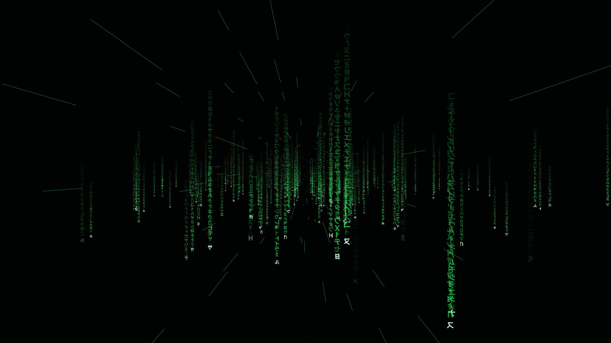

# Laser Code

A screensaver pack for [ScreenSafe](https://github.com/jeremydixon22/omarchy-screensafe) on Omarchy.

A warp-speed flight through columns of falling code. Columns of Katakana-like and ancient-script glyphs hang in space: tiny and dim in the distance, they rush closer, grow and stream past, while the characters in each column keep falling.

## Settings

- **Warp speed:** Drift, Cruise, Warp, Hyper
- **Fall speed:** Slow, Normal, Fast
- **Density:** Sparse, Normal, Dense, Packed, Swarm
- **Colour:** Green, Cyan, Amber, Red, Violet, White

## Where everything comes from

`glyphs.png` was rendered by script from the Noto fonts (SIL Open Font License): Noto Sans CJK JP (Katakana), Noto Sans Runic, Phoenician, Linear A, Linear B, Old Persian and Cuneiform. No generated imagery, photographs or likenesses. `preview.png` is a frame from `screensafe render`.

## License

CC0 1.0. See [LICENSE](LICENSE).
